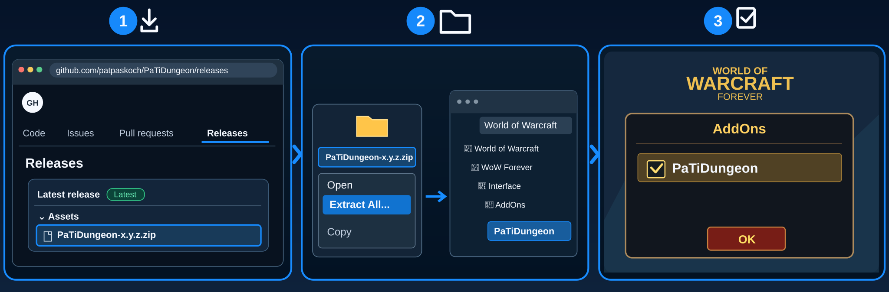

# PaTiDungeon

## Install

**📥 [Download PaTiDungeon Beta](https://github.com/patpaskoch/PaTiDungeon/releases/download/v0.1.0-beta.1/PaTiDungeon-0.1.0-beta.1.zip)** · [Installation guide](#installation)

*Installation-test preview — not yet a stable release.*

## What is PaTiDungeon?

**Every dungeon is an adventure worth mapping.**

Remember the path you've explored and the places you don't want to miss. PaTiDungeon gives you a simple personal map to sketch rooms, corridors and important spots as you go — **your adventure, your map.**

## Features

- **Know where you are:** See the current instance's name and type.
- **Draw your own map:** Sketch rooms and corridors as you explore.
- **Mark what matters:** Note bosses, chests, dangers and the entrance.
- **Pick up where you left off:** Keep a separate sketch for each dungeon.
- **Simple and manual:** Nothing is mapped automatically.

## Installation

1. 📥 **Download** – Open [GitHub Releases](https://github.com/patpaskoch/PaTiDungeon/releases) and download the `PaTiDungeon-<version>.zip` file under **Assets** (not **Source code (zip)**).
2. 📂 **Extract & Copy** – Right-click the ZIP, select **Extract All**, then copy the extracted `PaTiDungeon` folder into the WoW Forever client's `Interface/AddOns/` folder. No renaming is needed.
3. ☑️ **Enable in Game** – Start WoW, open the **AddOns** menu at character selection, tick **PaTiDungeon**, and click **OK**.

## Getting Started

- Enter a dungeon — the window updates by itself
- Pick a tool above the grid; left click paints (hold to paint along), right click erases. "Clear" needs two clicks.
  The arrow tool sets an arrow pointing up; click it again to turn it 45° (8 directions).
  ••• → Show map hides or shows the grid.
- `/pd test` shows example data

## Settings

`/pd settings` or ••• → Settings: language, scale, window lock.
- **Window:** panel opacity (30–100 %)

## Important notes

> **Installation-test beta available:** [Download the current ZIP from Releases](https://github.com/patpaskoch/PaTiDungeon/releases). This is an unverified preview for testing the installation, not a stable release.

> Status: 0.1.0, in development, not yet stable. Not yet tested in game since the rework.

## PaTiSuite

This addon is part of the **PaTiSuite** — a collection of small addons for World of Warcraft: Forever.
Each one is installed on its own and works on its own; none of them is needed by another.

- [PaTiSuite](https://github.com/patpaskoch/PaTiSuite) – optional control panel to show and hide the PaTi windows
- [PaTiHeal](https://github.com/patpaskoch/PaTiHeal) – healing: party frames, heal target, click casting, HoTs, dispels
- [PaTiAuras](https://github.com/patpaskoch/PaTiAuras) – buffs, procs, tracking, group buffs and weapon imbues
- [PaTiAggro](https://github.com/patpaskoch/PaTiAggro) – aggro for tank, healer and damage (formerly PaTiTank)
- [PaTiRota](https://github.com/patpaskoch/PaTiRota) – your own skill priority with cooldowns and fixed cast buttons
- [PaTiGroup](https://github.com/patpaskoch/PaTiGroup) – party awareness: tank, healer, roles and the tank's target
- [PaTiLead](https://github.com/patpaskoch/PaTiLead) – lead the group: raid markers, ready check and pull timer
- [PaTiQuest](https://github.com/patpaskoch/PaTiQuest) – selected quest and its objectives
- **PaTiDungeon** – instance name and type *(this addon)*
- [PaTiSocial](https://github.com/patpaskoch/PaTiSocial) – "Party Social": quick emote and message buttons
- [PaTiAlerts](https://github.com/patpaskoch/PaTiAlerts) – one window for open problems

### Goes well with (optional)

- [PaTiQuest](https://github.com/patpaskoch/PaTiQuest) – your selected quest and its objectives
- [PaTiLead](https://github.com/patpaskoch/PaTiLead) – manual group tools: raid markers, ready check, pull timer
- [PaTiSuite](https://github.com/patpaskoch/PaTiSuite) – shows and hides this window together with the other PaTi windows

## Commands

`/pd` or `/patidungeon` — alone: show/hide · `settings` · `test` · `show` · `hide` · `lock` · `unlock` ·
`reset` (position) · `debug` · `version`

## Development

Architecture, tests and engineering rules of the suite: [PaTiAdmin](https://github.com/patpaskoch/PaTiAdmin). PaTiAdmin is not a WoW addon — players do not install it. The shared UI code (PaTiShared) is already embedded in this addon's `Shared/` folder; there is nothing extra to install.

## Support

PaTiDungeon is free and open source, and it stays that way. If it makes your runs a bit better, you can buy me a coffee:
[ko-fi.com/patiaddons](https://ko-fi.com/patiaddons). Bug reports and ideas are just as welcome:
[Issues](https://github.com/patpaskoch/PaTiDungeon/issues).

## License

MIT — see [LICENSE](LICENSE). Copyright (c) 2026 Patrick Koch.
